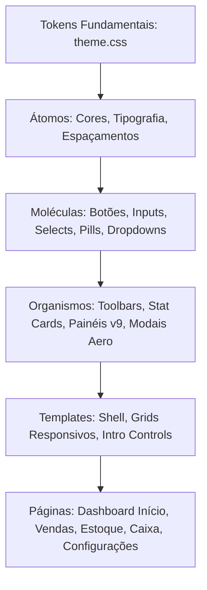

# 💎 Design System Aero 2.0 — BarGestão Standard
**Documentação Técnica de Arquitetura Visual, Tokens e Componentes**  
*Autor: Mariana (Especialista em Growth Marketing, UI/UX & Frontend Visual — Systekna)*  
*Versão:* 2.0.0 · *Status:* Aprovado em Produção · *Compatibilidade:* Desktop, Notebook, Tablet, Mobile  
*Template de Componentes (Living Styleguide):* [design-system.html](file:///home/celso/Documentos/GITHUB/GESTAO-CRM/multi-cm/docs/design-system.html) (isolado em `docs/`, fora da raiz de produção)

---

## 1. Visão Geral & Filosofia de Design

O **Design System Aero 2.0** combina a elegância translúcida e profundidade do estilo *Windows Aero Glass* clássico com as melhores práticas contemporâneas de *Glassmorphism 2.0*, tipografia suíça e otimização para aceleração gráfica via GPU (`translateZ(0)`).

### Pilares Fundamentais:
1. **Clareza Informacional & Redução de Carga Cognitiva:** Informações estruturadas hierarquicamente com métricas imediatas no padrão `[Título] -> [Valor] -> [Descrição]`.
2. **Glassmorphism 2.0 com Profundidade Real:** Uso calibrado de `backdrop-filter: blur(...) saturate(180%)`, bordas translúcidas de 1px com reflexo especular e sombras em camadas.
3. **Ergonomia & Touch Targets:** Altura padrão unificada de **42px** em todos os controles interativos (botões, inputs, selects, triggers de dropdown) e área mínima de toque de 44x44px em telas sensíveis.
4. **Conversão e Retenção (Growth Engine):** Micro-interações táteis, feedback visual instantâneo (`active: scale(0.985)`) e contraste estrito em conformidade com WCAG 2.1 AA.

---

## 2. Mapa Conceitual da Arquitetura (Mermaid)



---

## 3. Tokens de Design (Design Tokens)

Os tokens estão centralizados em `multi-cm/src/css/theme.css` e utilizam CSS Custom Properties nativas.

### 3.1. Paleta Cromática

| Token | Valor HSL / Hex / RGBA | Uso Semântico |
|---|---|---|
| `--bg` | `#eaf1fa` | Fundo base da aplicação |
| `--panel` | `rgba(255, 255, 255, 0.78)` | Cartões e painéis com efeito Glass |
| `--panel-solid` | `#ffffff` | Contêineres de alta opacidade e contraste |
| `--line` | `rgba(111, 140, 179, 0.22)` | Bordas externas translúcidas |
| `--line-highlight` | `rgba(255, 255, 255, 0.6)` | Reflexo superior especular em botões e modais |
| `--ink` | `#14253c` | Tipografia primária (alto contraste) |
| `--muted` | `#677b96` | Tipografia secundária, legendas e labels |
| `--accent` | `#266de0` | Cor de destaque, botões primários e CTAs |
| `--accent-hover` | `#1757be` | Estado hover de ações primárias |
| `--accentSoft` | `#e5efff` | Fundo de destaque suave e tags ativas |
| `--good` | `#0f8664` | Sucesso, status ativo e confirmações |
| `--good-bg` | `#e2f7ef` | Fundo para badges de sucesso |
| `--warn` | `#c27c0e` | Alertas de atenção e estoque baixo |
| `--warn-bg` | `#fff5e0` | Fundo para badges de alerta |
| `--bad` | `#c74550` | Erros, ações destrutivas e sangrias |
| `--bad-bg` | `#ffebee` | Fundo para badges de erro/perigo |

### 3.2. Efeitos Aero & Profundidade Óptica

```css
:root {
  --panel-blur: 18px;
  --modal-blur: 28px;
  --sidebar-blur: 24px;
  --topbar-blur: 16px;
  --shadow-sm: 0 4px 14px rgba(32, 59, 95, 0.05);
  --shadow: 0 14px 45px rgba(40, 68, 108, 0.085);
  --shadow-lg: 0 28px 75px rgba(25, 52, 90, 0.16);
  --shadow-modal: 0 35px 110px rgba(18, 38, 68, 0.28);
}
```

### 3.3. Escala Modular de Espaçamento (8pt / 4pt Grid)

| Token | Dimensão | Aplicação Típica |
|---|---|---|
| `--space-3xs` | `2px` | Micro-deslocamentos e ajustes finos |
| `--space-2xs` | `4px` | Espaçamento interno em labels e chips |
| `--space-xs` | `8px` | Gaps de botões e ícones |
| `--space-sm` | `12px` | Gaps entre controles e cards compactos |
| `--space-md` | `16px` | Padding interno de cards e margens de toolbar |
| `--space-lg` | `20px` | Gaps de grid e margens de seção |
| `--space-xl` | `24px` | Padding principal de cartões e modais |
| `--space-2xl` | `32px` | Respiro vertical de títulos e seções |
| `--space-3xl` | `40px` | Margens de topo de layouts desktop |

### 3.4. Rolagem (Scroll)

| Token | Valor | Uso |
| :--- | :--- | :--- |
| `--scroll-size` | `10px` | Largura/altura da barra no Safari (`::-webkit-scrollbar`) |
| `--scroll-thumb` | `rgba(103, 123, 150, 0.26)` | Barra em repouso: fina e quase invisível |
| `--scroll-thumb-hover` | `rgba(38, 109, 224, 0.5)` | Barra ao passar o mouse sobre a área (cor de acento) |
| `--scroll-fade` | `28px` | Comprimento do esmaecido nas bordas de `.scroll-area` e `.scroll-x` |

### 3.5. Tipografia & Escala Hierárquica

- **Família Tipográfica:** `Inter, -apple-system, BlinkMacSystemFont, "Segoe UI", Roboto, sans-serif`
- **Títulos:**
  - `H1 (.page-title)`: `clamp(23px, 2.6vw, 30px)` · Peso 800 · Letter-spacing: `-0.8px`
  - `H2 (.card h2)`: `16px` · Peso 750 · Letter-spacing: `-0.3px`
  - `Eyebrow (.eyebrow)`: `10.5px` · Peso 800 · Letter-spacing: `1.5px` · Uppercase
- **Métricas:**
  - `Stat Value (.stat strong)`: `clamp(23px, 2.3vw, 29px)` · Peso 850 · `white-space: nowrap`

---

## 4. Biblioteca de Componentes (Catálogo de Átomos e Moléculas)

### 4.1. Botões (`.btn`)
Altura base padronizada de **42px**, transição suave com aceleração GPU e feedback tátil em clique ativo (`transform: scale(0.985)`).

- **Primário (`.btn`):** Fundo `--accent`, texto branco, sombra azul translúcida. Usado para o CTA principal da tela.
- **Secundário / Ghost (`.btn.ghost`):** Fundo translúcido `rgba(235, 242, 252, 0.85)`, borda fina. Usado para ações secundárias e filtros.
- **Perigo (`.btn.danger`):** Fundo vermelho suave `--bad-bg`, texto `--bad`, borda destrutiva.
- **Outline (`.btn.outline`):** Borda suave com preenchimento branco translúcido.
- **Bloco (`.btn.block`):** Ocupa 100% da largura do contêiner.
- **Minor (`.btn.minor`):** Variante compacta de 36px para ações em tabelas e listas.

### 4.2. Badges de Status (`.pill`)
Pílulas compactas com tipografia em peso 750 e bordas arredondadas (8px):
- `.pill`: Neutro / Informativo (fundo `#e6effc`, texto `#2c68c1`).
- `.pill.good`: Sucesso / Ativo (fundo `--good-bg`, texto `--good`).
- `.pill.warn`: Alerta / Estoque Baixo (fundo `--warn-bg`, texto `--warn`).

### 4.3. Dropdown Unificado Aero (`#cash-export-dropdown`)
Controle flutuante com menu em Glassmorphism 2.0:
- **Gatilho (`.dropdown-trigger`):** Altura 42px, ícone chevron com rotação fluida via CSS (`transform: rotate(180deg)` quando aberto).
- **Menu suspenso (`.dropdown-menu`):** `backdrop-filter: blur(16px) saturate(180%)`, animação `@keyframes dropdown-in` com cubic-bezier suave, fechamento automático ao clicar fora ou ao pressionar tecla `Escape`.

### 4.4. Cards de Estatística (`.stat`)
Layout em pilha vertical rígida:
```
[ TÍTULO DA MÉTRICA ]  --> .stat-label (11.5px, uppercase, --muted)
[ VALOR QUANTITATIVO ] --> strong (26px, bold 850, --ink, nowrap)
[ LEGENDA EXPLICATIVA] --> small / .stat-foot (11.5px, --muted)
```
Hover com elevação translúcida (`translateY(-2px)` e sombra suave).

### 4.5. Toolbars de Ação (`.toolbar`)
Container flexível que garante alinhamento estrito:
- `.toolbar-title-group`: Título `h2` e Badge `.pill` alinhados lado a lado à esquerda.
- `.toolbar-actions`: Conjunto de botões de ação à direita. No mobile, expandem para 100% empilhados verticalmente.

### 4.6. Barra de Controles do Caixa (`.intro-controls`)
Resolve o alinhamento entre campos com rótulo (`.period-select`) e botões puros via `align-items: flex-end`, equalizando a altura da base em 42px.

### 4.7. Modais Aero (`.aero-modal`)
Diálogos construídos sobre a tag nativa `<dialog>`, com animação de escala, backdrop escurecido com desfoque de 28px e cabeçalho com barra de kicker.

### 4.8. Rolagem Aero (`theme.css`)
Minimalista, discreta e elegante, sem JavaScript:
- **Global:** `scrollbar-width: thin` + `scrollbar-color` (Firefox e Chrome 121+) e `::-webkit-scrollbar` (Safari). Trilho transparente; a barra fica quase invisível em repouso e ganha a cor de acento no hover. Listas que escondem a barra (`.category-chips`, menu lateral) continuam com `scrollbar-width: none`.
- **Âncoras:** `scroll-behavior: smooth` (desligado com `prefers-reduced-motion`) e `scroll-padding-top` igual à topbar, para o título não ficar atrás dela.
- **`.scroll-area`:** rolagem vertical própria com altura máxima em `--scroll-max` (padrão 320px), `overscroll-behavior: contain` e `scrollbar-gutter: stable`.
- **`.scroll-x`:** faixa horizontal para chips e cards, com `scroll-snap` nos itens e barra escondida.
- **Bordas esmaecidas inteligentes:** as duas classes esmaecem só o lado em que ainda há conteúdo, com `animation-timeline: scroll(self)` e as propriedades registradas `--fade-ini`/`--fade-fim`. Sem suporte, fica o esmaecido fixo do lado final.

### 4.9. Outros componentes catalogados
O catálogo vivo (`docs/design-system.html`, 26 seções) mostra, com a marcação real do app:
- **Layout:** esquema `.shell` › `.sidebar` + `.app` › `.topbar` + `.content`, topbar com `.vp-bar`/`.top-title`/`.profile`, `.field-grid` com `.span2`, `.sku-help` e `.form-help`.
- **Login:** `.auth-box` (sobre `.auth-overlay`), `.auth-tabs`, `.bio-login-help`, `.autofill-note`, `.backup-login`.
- **Início:** `.home-head` (com `.dot`), `.home-hero` (`.hero-copy`, `.hero-kicker`, `.hero-action`, `.hero-art`, `.art-ring`), `.home-card`, `.home-table-list`/`.home-mini-row`, `.home-empty` (e `.good`).
- **Mesas, comanda e estoque:** `.mesa-entry` com `.itemline`, `.cmd-head`/`.cmd-icon-btn`, `.cmd-new`, `.category-chips`, `.product-choice` + `.cmd-badge`, `.cmd-item`, `.cmd-pay` + `.cmd-pay-actions`, `.cmd-total-row`; produto com `.item-id` e `.entry-right`, movimentação com `.text-good`/`.text-bad`, `.inline-fields` e `.small-list`.
- **Caixa:** `.cash-stats`, `.cash-lower-stats`, `.cash-quick`, `.cash-export-notice`, livro caixa, `.audit-record`, `.receipt-preview`, `.chart-bars`.
- **Menu Mais:** `.more-profile`, `.bio-entry` + `.bio-diagnostic`, `.group-title`, `.more-group`/`.more-link` + `.more-chevron`, `.version-card`, `.version-label`.
- **Feedback:** `.empty`, `.toast`, `.notice`, `.error`, `.v9-panel` + `.v9-note`, `.recovery-word-grid`.
- **Kit de segurança** (`PACOTES/stk-pkg-security` + tema `kit-aero.css`): folha de configurações (`.fs-head`, `.fs-body`, `.fs-row`, `.fs-switch`, `.fs-select`, `.fs-seg`, `.fs-badge-*`, `.fs-danger`, `.fs-toast`), painel do perfil (`.vp-*`), senha com olho (`.pw-wrap`), tela de bloqueio (`#vaultGate`, `.vault-keypad`, `.vault-dots`), diálogo de PIN (`.vault-dialog`) e lembrete de backup (`#vaultBackupNudge`). O `kit-aero.css` zera o `min-height` global de botão nos controles de tamanho fixo do kit (`.fs-switch`, `.fs-back`, `.vp-close`, `.fs-seg button`).
- Ícone dentro de pill: `.pill svg` (12px).

---

## 5. Diretrizes de Responsividade (Breakpoints Multi-Tela)

1. **Mobile (< 768px):**
   - **Menu inferior fixo (`.mobile-nav`):** Dock Aero com `backdrop-filter: blur(24px)`, `z-index: 40`, alinhamento tátil aos polegares e suporte a `safe-area-inset-bottom`.
   - **Modais em Bottom Sheet:** Modais deslizam suavemente a partir da base (`@keyframes sheet-up`, raio superior de 24px) com altura máxima de 92dvh.
   - **Rodapé Fixo de Pedido (`.sticky-submit`):** Fixação `position: sticky; bottom: 0;` com Glassmorphism (`backdrop-filter: blur(16px)`), mantendo o total acumulado e o botão primário visíveis sem exigir scroll.
   - **Ergonomia de Comandas (`.mesa-entry`):** Botão primário "Adicionar pedido" ocupa 100% da largura superior (`grid-column: span 2`), e ações secundárias ("Cliente" e "Receber") dividem a linha inferior em 50% / 50%.
   - **Carrossel Tátil de Categorias (`.category-chips`):** Deslize horizontal com `scroll-snap-type: x mandatory` e amortecimento inercial tátil.
   - **Fechamento de Comanda (`.receipt-preview`):** Tipografia de 30px bold e fundo gradiente aero para alta legibilidade sob luz natural.
   - **Toolbars e Formulários:** Expansão fluida a 100%, touch targets mínimos de 44px e prevenção de zoom automático via fontes >= 15px em inputs.
2. **Tablets (768px - 1024px):** Grid de 2 colunas, menus colapsados com toques aumentados.
3. **Notebooks & Laptops (1025px - 1440px):** Layout baseline desktop, sidebar fixa de 248px, grids fluidos de até 4 colunas.
4. **Monitores Ultrawide / 4K (> 1440px):** Sidebar expandida para 268px, largura de conteúdo limitada a 1760px para conforto ergonômico visual.

---

## 6. Checklist de Acessibilidade & Performance
- [x] Contraste de texto mínimo 4.5:1 em elementos estáticos.
- [x] Todos os controles interativos com estados `:focus-visible` de 3px com anel de foco azul (`#82b0fc`).
- [x] Áreas de toque mínimas de 42px / 44px para conformidade com telas sensíveis.
- [x] Aceleração gráfica por GPU ativada através de `transform: translateZ(0)` nos painéis Aero.
- [x] Suporte a `prefers-reduced-motion: reduce` desativando animações pesadas.
