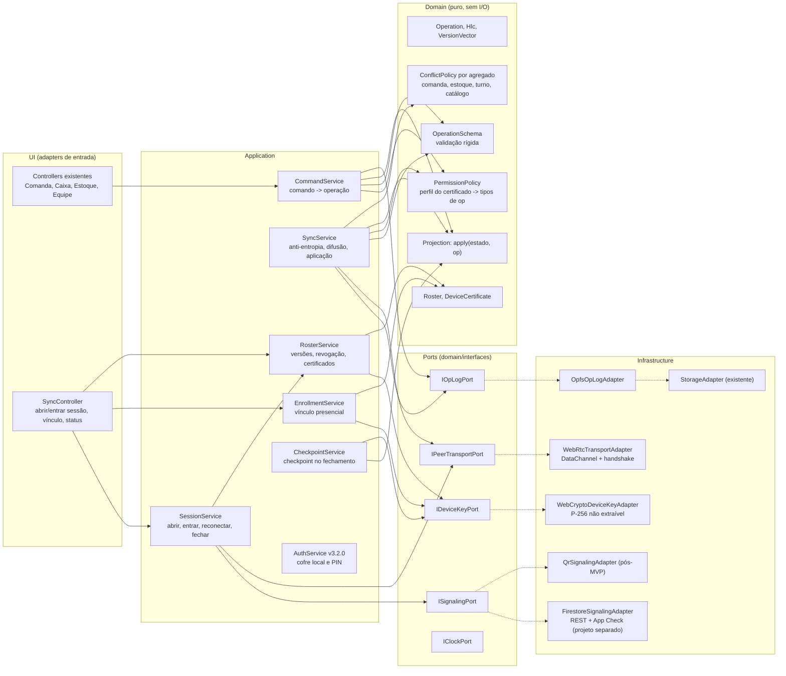
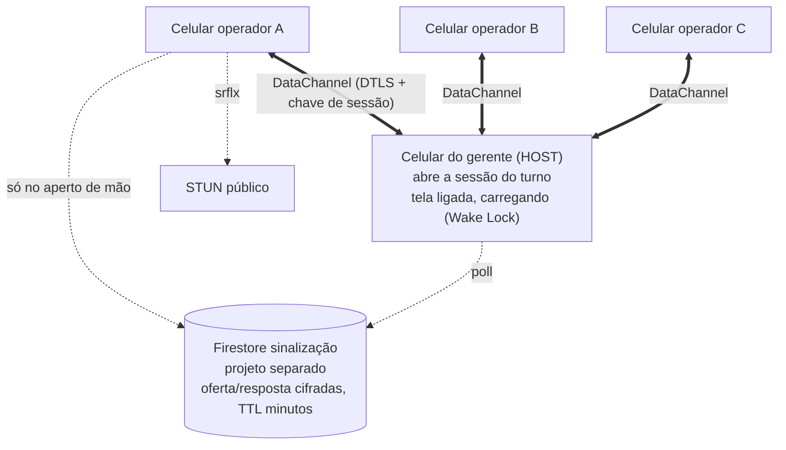
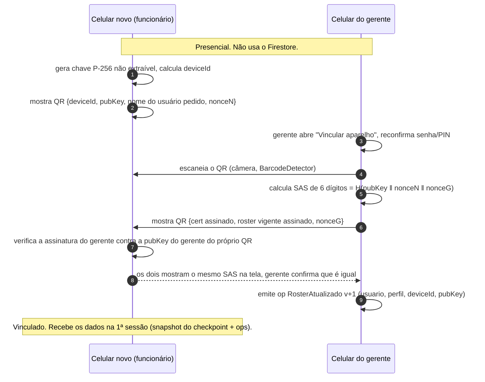
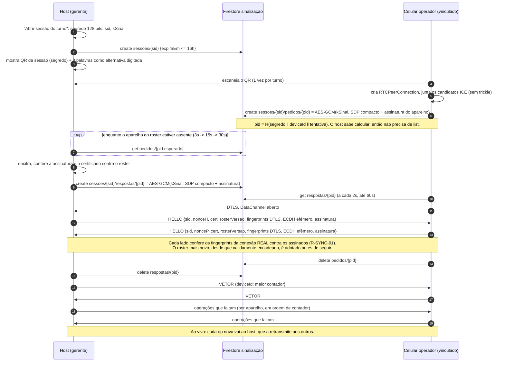
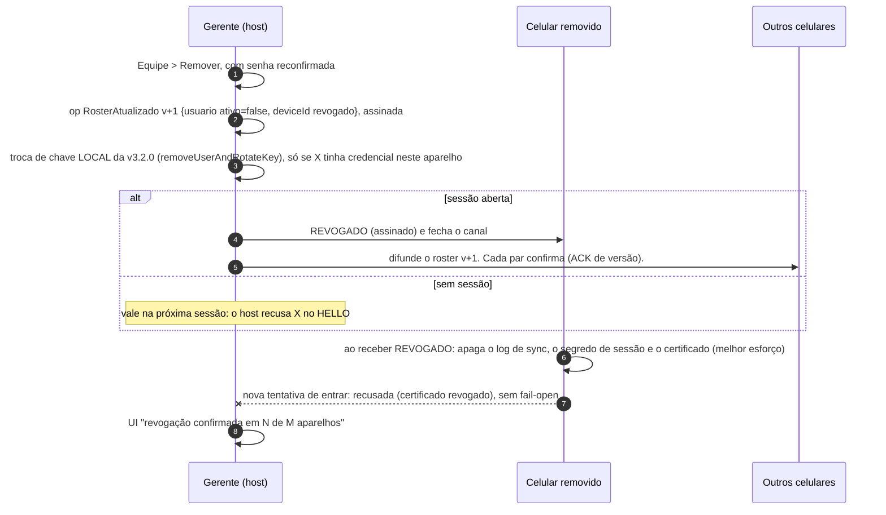

# SPEC: sincronização entre celulares por sessão (BarGestão)

## 0. Resumo executivo

- **Decisão do Celso (21/10/2026, refinada):** cada funcionário usa o próprio celular, vinculado ao aparelho. Todos veem as mesmas comandas, o mesmo estoque e o mesmo caixa. Remover o usuário bloqueia o celular dele. **O Firebase não guarda nenhum dado do bar, nem cifrado.** Ele só ajuda a abrir a conexão. Os dados passam direto entre os aparelhos numa **sessão** aberta pelo gerente.
- **Recomendação:** WebRTC DataChannel em **estrela**, com o celular do gerente como anfitrião (host) da sessão do turno. A sinalização (oferta, resposta e ICE) fica no Firestore só por alguns minutos, cifrada e num **projeto Firebase separado**. Os dados viram um **log de operações assinadas por aparelho** que converge sozinho. Nenhum aparelho é "dono da verdade": o host conecta e retransmite, mas não escreve a verdade.
- **Cabe no plano gratuito:** sim. Só a sinalização gasta cota. Um bar típico gasta cerca de **3.800 leituras e 135 gravações por noite**, ou seja, 7,7% das leituras e 0,7% das gravações diárias do Spark. No piloto sobra cerca de 92%. O teto prático é de uns 13 bares por projeto com Firestore REST, e passa de 80 se a sinalização migrar para o Realtime Database (seção 6.5).
- **Custo honesto:** sem TURN (pago), dois celulares em 4G com NAT simétrico podem não se conectar. Há três saídas sem custo: o Wi-Fi do bar, o **roteador do celular do gerente** (hotspot) e, depois do MVP, o QR. Até lá o app continua funcionando sozinho e sincroniza no próximo encontro.
- **Esforço do MVP:** 45 dias-dev, numa faixa de 38 a 52 (cerca de 9 semanas com 1 dev), em 7 fases, começando por uma prova de conceito (F0) em celulares Android reais que decide se o projeto segue.

## 1. Objetivo, escopo e atores

### 1.1 Objetivo

Permitir que de 2 a 6 celulares do mesmo bar trabalhem nas mesmas comandas, no mesmo estoque e no mesmo caixa, cada um no próprio aparelho, sem servidor que guarde dado, sem custo e funcionando offline.

### 1.2 Atores

| Ator | Papel no sync |
|---|---|
| Gerente | Tem a raiz de confiança do estabelecimento. Vincula e remove aparelhos, abre e fecha a sessão do turno (host), fecha o caixa, faz ajustes. |
| Operador (funcionário) | Usa o próprio celular vinculado. Lança itens, cancela itens (decisão v3.1.0), recebe comandas, vende no balcão. |
| Aparelho host | Celular do gerente que abre a sessão. Ponto de encontro e retransmissor das operações. Não é autoridade sobre o estado. |
| Firestore (projeto de sinalização) | Canal **hostil por definição**. Guarda por minutos uma oferta ou resposta cifrada. Não vê dados do bar. |
| STUN público | Informa IP e porta públicos. Não carrega dados. |

### 1.3 Fora do escopo deste SPEC

Código de produção, regras publicadas, alterações em `PACOTES/`, TURN pago, sincronização entre estabelecimentos diferentes, escopo fiscal ou LGPD formal.

## 2. Estado atual (v3.2.0), lido no código

| Ponto | Como é hoje | Impacto no sync |
|---|---|---|
| Persistência | Um único **snapshot** JSON cifrado (`BG:v7:operacional:{seq}`) em slots A/B no OPFS (`StorageAdapter`), com contingência em localStorage e IndexedDB. | Snapshot inteiro não se funde entre aparelhos: precisa virar log de operações (seção 5). |
| Mutação | `App._commit(mutationfn, rótulo)` aplica uma **closure** sobre um `structuredClone` dos dados e grava o snapshot inteiro. | É a maior refatoração: cada closure vira um **comando que gera uma operação nomeada** (F1). |
| Auditoria | Cadeia de hash **única e linear** (`auditoria[]`, `_verifyAuditTrail`). | Passa a haver uma cadeia **por aparelho**. A visão global é a fusão por HLC. |
| Usuários | `meta.usuarios[]`: cada usuário embrulha a **mesma** chave do cofre com a própria senha (`wrapKey`). PIN v2 = KEK por PBKDF2 do PIN + `deviceSeal` não extraível. | Cada celular passa a ter o **próprio** cofre, só com o usuário dele. Usuários, perfis e aparelhos vão para o **roster assinado**. |
| Remover usuário | `removeUserAndRotateKey`: chave nova, recifra o cofre, reembrulha para quem fica, revoga PINs, renova as 12 palavras. Gravação atômica em 3 passos. | Reaproveitado **localmente** nos aparelhos onde o removido tinha credencial (fundador, celular compartilhado). A revogação do **aparelho** é uma operação do roster (LP-06 do Pedro). |
| Concorrência | `navigator.locks` + `BroadcastChannel` entre abas do mesmo aparelho. | Continua, porque o log local tem um único gravador por aparelho. |
| Governança | `GovernanceService` lê o tenant pelo UID do **estabelecimento** (hash do cadastro), via REST + App Check no `systekna-feedback`. | Continua igual e por aparelho. **Não** serve de credencial entre aparelhos (o UID é semipúblico). |
| `innerHTML` | 4 usos: `App.js:654`, `App.js:688` (literais fixos), `CashController.js:245` e `:258` (o `:258` interpola valores do turno formatados por `money()`). | Pela R-SYNC-07 são reescritos com nós DOM e `textContent` antes de qualquer dado remoto chegar à UI. |

## 3. Arquitetura

### 3.1 Visão de componentes (hexagonal)



Caminhos previstos (nada criado agora):

- Domain: `src/js/domain/sync/` (`Operation.js`, `Hlc.js`, `VersionVector.js`, `Projection.js`, `ConflictPolicy.js`, `PermissionPolicy.js`, `Roster.js`, `DeviceCertificate.js`, `OperationSchema.js`) e as ports em `src/js/domain/interfaces/` (`IOpLogPort.js`, `IPeerTransportPort.js`, `ISignalingPort.js`, `IDeviceKeyPort.js`, `IClockPort.js`).
- Application: `src/js/application/services/` (`CommandService.js`, `SyncService.js`, `SessionService.js`, `EnrollmentService.js`, `RosterService.js`, `CheckpointService.js`).
- Infrastructure: `src/js/infrastructure/adapters/` (`OpfsOpLogAdapter.js`, `WebRtcTransportAdapter.js`, `FirestoreSignalingAdapter.js`, `WebCryptoDeviceKeyAdapter.js`).
- UI: `src/js/ui/controllers/SyncController.js`, com ícones SVG do `FinancIcons` e componentes do design system (sem estilo novo e sem emoji).

### 3.2 Topologia: estrela com host retransmissor (MVP)



- **Por que estrela no MVP:** com N aparelhos são N-1 conexões em vez de N(N-1)/2. A sinalização é mais simples (só o host consulta o Firestore) e, no fallback por QR (pós-MVP), cada operador troca QR só com o gerente. Com o host sendo gerente, que tem o roster mais novo, **a revogação vale de imediato** na sessão seguinte (seção 4.5).
- **Por que isso não cria um "dono da verdade":** cada operação é assinada pelo aparelho **autor**. O host só retransmite. Ele pode atrasar ou omitir, mas não forjar nem alterar (HO-01 do Pedro). Todo aparelho reaplica esquema, permissão e regras de conflito. O estado é uma função determinística do conjunto de operações.
- **Malha (pós-MVP, F8):** o host repassa, pelo próprio DataChannel, a sinalização entre dois operadores, que passam a se conectar direto **sem usar o Firestore**. Isso reduz a dependência do host (HO-02) e é pré-requisito para um operador abrir uma sessão de contingência.

### 3.3 Quem é o "dono" da verdade

| Pergunta | Resposta |
|---|---|
| Onde está a verdade? | Na **união dos logs de operações assinadas** de todos os aparelhos do roster. Ela converge: dois aparelhos com o mesmo conjunto de operações têm o mesmo estado, byte a byte. |
| O host consolida? | Não consolida estado. Ele é ponto de encontro e retransmissor. |
| Qual a autoridade do gerente? | Sobre **regras**, não sobre o estado: roster (vincular e revogar), fechamento de caixa, ajustes de estoque, estorno, import de backup. São operações que só passam se assinadas por um certificado de perfil `gerente` (R-SYNC-06). |
| E o checkpoint? | No fechamento do turno, o gerente assina um checkpoint (hash do estado + vetor de versões). Quem tem o mesmo vetor confere se o hash bate com o seu. Se divergir, alerta e bloqueio (HO-01). O checkpoint também serve de base para aparelhos novos e para podar o log. |

## 4. Identidade, vínculo, sessão e revogação

### 4.1 Material criptográfico

| Item | Onde nasce | Onde fica | Observação |
|---|---|---|---|
| Chave do aparelho (ECDSA P-256) | No próprio celular, no 1º uso do modo equipe | IndexedDB `device`, `CryptoKey` **não extraível** (mesmo padrão do `device-wrap`) | `deviceId` = 16 bytes do SHA-256 da chave pública. Usada só com o cofre aberto (R-SYNC-13). WebAuthn/passkey fica para depois do MVP. |
| Raiz do estabelecimento | **Não é uma chave única.** É o conjunto de chaves de aparelho com perfil `gerente` no roster vigente, mais a chave de recuperação. | Em cada aparelho de gerente | Roster v(n+1) só vale se assinado por um aparelho que era gerente no roster v(n). Nenhuma chave privada sai do aparelho. |
| Chave de recuperação da raiz (ECDSA P-256) | Derivada das **12 palavras** (BIP39-pt), com separação de domínio `HKDF(info="BG:sync:raiz-recuperacao:v1")` | Não é guardada. É derivada quando as palavras são digitadas. | Atende a C8 e RV-05: com todos os celulares de gerente perdidos, um aparelho novo mais as 12 palavras assinam um roster que revoga os perdidos. |
| Certificado do aparelho | Emitido pelo gerente no vínculo e renovado em cada sessão | No aparelho e no roster | `{deviceId, usuario, perfil, pubKey, emitidoEm, validoAte (7 dias), rosterVersao}`, assinado por um gerente. **O perfil vem daqui, nunca da mensagem.** |
| Segredo da sessão | No host, ao abrir a sessão (128 bits) | Memória do host e dos pares durante a sessão | Dele saem: `sid = HKDF(..,"BG:sinal:id")`, `kSinal = HKDF(..,"BG:sinal:enc")` e os IDs dos documentos de sinalização. |
| Chave de canal | ECDH efêmero no handshake, `HKDF(salt=nonces, info=fingerprints DTLS ‖ sid)` | Memória, zerada ao bloquear ou fechar (R-SYNC-10) | Segunda camada sobre o DTLS (CN-05), com nonce AEAD por contador. |
| Chave do cofre local | Por aparelho (como hoje) | OPFS, embrulhada pela senha e pelo PIN v2 do usuário do aparelho | **Não existe chave de dados compartilhada de longa duração** (R-SYNC-14 e RV-04). |

**Consequência importante:** com as chaves por aparelho, remover alguém **não obriga** o gerente a redefinir a senha de todos, como na v3.2.0 (lá era preciso porque todos abriam a mesma chave no mesmo celular). Cada celular tem o próprio cofre. A troca de chave da v3.2.0 continua só onde o removido tinha credencial local.

### 4.2 Vínculo de aparelho novo (presencial, aprovado pelo gerente)



Regras:

- Um aparelho por usuário (EN-03). Trocar de celular é um novo vínculo, e o aparelho antigo é revogado na mesma operação.
- Só um aparelho de gerente aprova, e sempre com a senha reconfirmada. A aprovação gera uma operação de roster, que fica auditada.
- Vínculo remoto (SAS lido por voz) fica fora do MVP.
- O usuário precisa existir no cadastro da equipe (v3.2.0). O vínculo cria a credencial **local** do funcionário no celular dele: ele define a própria senha e o próprio PIN no aparelho, e o gerente não fica sabendo de nenhum dos dois.

### 4.3 Abrir a sessão, entrar e reconectar



- **Sem `list` em lugar nenhum.** O host só faz `get` dos IDs que sabe calcular, um por aparelho do roster ausente. Isso atende SG-03.
- **Reconexão:** quando o celular do operador vai para o bolso, o Android suspende a aba e o canal cai. Ao voltar, ele usa o segredo da sessão guardado no cofre durante o turno e a próxima tentativa (`tentativa+1`), sem escanear de novo. É o caminho **mais comum** da noite, não exceção.
- **SDP compacto:** só `ice-ufrag`, `ice-pwd`, fingerprint, `setup` e os candidatos (mDNS no lugar do IP local quando o Chrome oferece), remontado do outro lado. Fica entre 400 e 700 bytes, cabe nos 4 KB das regras e cabe num QR (base do fallback B).
- **Janela de entrada:** o QR da sessão vale 5 minutos para a 1ª entrada (EN-02). O gerente reabre com "Liberar entrada". Para quem já entrou no turno, a reconexão vale até a sessão fechar.
- **Fechar a sessão:** o host envia `SESSAO_FECHADA` assinado, os pares fecham os canais e zeram as chaves de sessão, e o host apaga `sessoes/{sid}` e os documentos que restarem. O TTL do Firestore cobre o que sobrar, e a regra nega leitura depois do vencimento.
- **Host:** a tela fica ligada pela Wake Lock API, e o aparelho deve ficar no carregador. Se o host fechar ou cair, os operadores continuam trabalhando offline e o gerente reabre a sessão.

### 4.4 Celular que cai da sessão, fica offline e volta

| Situação | Comportamento |
|---|---|
| Queda curta (tela apagada, 4G oscilou) | O app continua 100% local: a operação é gravada no log local e aplicada à projeção na hora. O indicador mostra "não sincronizado (N)". Ao voltar, o aparelho reconecta pela tentativa seguinte, troca vetores e envia o que falta. |
| Offline durante a noite toda | Funciona sozinho. Na próxima sessão em que encontrar o host, a anti-entropia leva tudo. As operações de turno já fechado entram como **lançamento após o fechamento** (seção 5.4), sem mudar o fechamento assinado. |
| Offline por muitos dias | O certificado vence em 7 dias. Ele continua trabalhando localmente, mas na reconexão o host renova o certificado antes de aceitar as operações. Se o aparelho tiver sido revogado nesse meio-tempo, as operações vão para **quarentena** (o gerente aceita ou descarta; decisão pendente, P-08). |
| Celular perdido antes de sincronizar | As operações que só existiam nele se perdem. Isso é risco aceito e exige sessão frequente e backup (Pedro, seção 7, item 3). |
| Conflito na volta | Resolvido por regra de domínio (seção 5.3), nunca por "último que grava ganha". |

### 4.5 Remover usuário = bloquear o aparelho



- **Bloqueio no MVP é imediato** porque só um aparelho de gerente aceita conexões, e o gerente tem o roster mais novo. Com mais de um gerente, eles trocam o roster no HELLO. A janela de exposição só aparece quando houver malha ou host operador (pós-MVP). Para esse caso, o certificado de 7 dias e a propagação do roster no handshake limitam a janela (RV-01).
- **O que não dá para fazer, e é dito ao Celso:** apagar à distância o que o celular removido já tinha (RV-03). Se ele ficar offline, mantém a cópia local. Essa mitigação é contratual e de LGPD.
- **Celular do gerente perdido:** outro gerente, ou o aparelho novo com as 12 palavras, assina um roster que revoga o perdido. Se a raiz inteira for comprometida, o estabelecimento recomeça com novo roster genesis e todos se re-vinculam presencialmente (C8).

### 4.6 Matriz de permissões (aplicada por **todo** par, a partir do perfil do certificado)

| Operação | Gerente | Operador |
|---|---|---|
| Adicionar item, abrir comanda, venda balcão, receber comanda | sim | sim |
| Cancelar item (decisão v3.1.0) | sim | sim |
| Abrir turno, registrar retirada (sangria) | sim | a decidir (P-05). Hoje o botão de retirada é `manager-only`. |
| Fechar caixa / turno, checkpoint | sim | não |
| Cadastro e edição de produto, preço, categoria; ajuste ou contagem de estoque; entrada de estoque | sim | não (entrada de estoque: P-05) |
| Estorno, resolução de conflito de pagamento | sim | não |
| Roster: vincular, revogar, mudar perfil; abrir e fechar sessão (MVP) | sim | não |
| Importar backup (por mesclagem), reset | sim | não |

Operação fora da matriz é **descartada e registrada como incidente**, sem aplicar parcialmente (R-SYNC-18).

## 5. Modelo de dados e sincronização

### 5.1 Comparação de abordagens

Critérios ponderados para o contexto do BarGestão (dinheiro e estoque, de 2 a 6 aparelhos, PWA sem build, offline frequente):

| Critério (peso) | A. Log de operações append-only + projeção por regras de domínio | B. CRDT genérico (Automerge / Yjs) | C. Último que grava, por campo, sobre o snapshot atual |
|---|---|---|---|
| Corretude financeira e de estoque (5) | 5: regras explícitas (estoque por movimento, comanda fechada imutável) | 3: converge, mas não conhece invariantes (estoque negativo, fechamento com itens concorrentes) e as regras ficariam fora dele | 1: perde item quando dois lançam na mesma comanda e perde baixa de estoque concorrente |
| Auditoria e não repúdio (4) | 5: a operação assinada é o próprio registro | 3: os updates são binários opacos, precisaria de camada extra | 1: só o resultado final |
| Encaixe com a segurança do Pedro (C4, R-SYNC-05/06) (4) | 5: assinatura, contador e perfil por operação são naturais | 2: assinar updates do CRDT e validar perfil por campo é trabalho próprio | 2: daria para assinar, mas a perda de dados persiste |
| Dependências e peso (3) | 5: zero | 2: Automerge tem WASM de ~1 MB; Yjs é ~70 KB, mas é uma dependência a mais (AGENTS.md §4) | 5: zero |
| Esforço de implementação (3) | 3: refatorar `_commit` em comandos (F1) | 3: integrar e mapear o modelo; esforço menor no merge, maior nas regras | 5: pouco esforço |
| Determinismo e testabilidade (3) | 5: reducers puros, replay em teste | 4 | 3 |
| **Total ponderado (máx. 110)** | **104** | **62** | **56** |

**Recomendação: A.** Na prática, A é um CRDT baseado em operações **desenhado para o domínio**: as operações comutam por construção (conjuntos com ID único, contadores somados, registro LWW só onde não há dinheiro), e as regras de negócio que um CRDT genérico não conhece ficam explícitas e testáveis. C está descartado por perder dinheiro. B resolve um problema (texto e edição colaborativa) que o bar não tem e cobra dependência e opacidade.

### 5.2 Operação (envelope)

```
Operation {
  v: 1,
  id: uuid,
  dev: deviceId,                 // autor
  ctr: inteiro >= 1,             // contador monotônico por aparelho (sem buracos)
  prev: sha256(op anterior deste aparelho) | "GENESIS",
  hlc: { pt: ms, l: inteiro },   // Hybrid Logical Clock; desempate final = dev
  usuario: string,               // conferido contra o certificado de dev
  tipo: enum,                    // ver 5.3
  dados: objeto validado por OperationSchema[tipo],
  sig: ECDSA-P256(canonical(op sem sig))
}
```

- **Validação na chegada (R-SYNC-07), nesta ordem:** tamanho (≤ 16 KB por op e ≤ 64 KB por mensagem) → JSON sem `__proto__`, `constructor` ou `prototype` → esquema estrito do `tipo` (campos, tipos, limites; padrão do `BackupService.parse`) → `dev` no roster, não revogado, certificado válido → `usuario` igual ao do certificado → `PermissionPolicy(perfil, tipo)` → assinatura → `ctr` (repetido igual é descartado sem efeito; repetido diferente ou buraco indica **fork**, e o aparelho é bloqueado com alerta ao gerente, LP-03) → `prev` encadeado → HLC dentro da deriva (até 5 min no futuro em relação ao receptor; acima disso vai para quarentena, CN-03).
- **Armazenamento local:** log por aparelho autor no OPFS (`OpfsOpLogAdapter`), cifrado com a chave do cofre local. A projeção (estado atual) continua sendo gravada como snapshot nos slots A/B, como cache do replay, e o código atual de leitura continua valendo.
- **Ordem de aplicação:** ordenação total por `(hlc.pt, hlc.l, dev)`. Uma operação nova com HLC maior que a última aplicada é incremental. Uma operação "antiga" que chega depois (aparelho que estava offline) dispara o **replay a partir do último checkpoint**. Na escala do bar (milhares de ops) isso leva menos de 1 s, a medir na F1.

### 5.3 Tipos de operação e resolução de conflito por agregado

| Agregado | Operações | Regra de convergência | Conflito típico e resultado |
|---|---|---|---|
| Comanda (mesa ou balcão) | `ItemAdicionado {mesa, itemId, produtoId, qtd, precoUnit, custoUnit}`, `ItemCancelado {itemId, motivo}`, `ClienteDefinido {mesa, nome}`, `ComandaRecebida {mesa, itemIds[], valor, forma, turnoId}` | Itens = conjunto com ID único (união). Cancelar = lápide sobre o `itemId`. `ClienteDefinido` = LWW por HLC. O preço vai **dentro** da operação (mudança de preço depois não altera venda feita). | **Dois garçons lançam na mesma mesa:** ficam os dois itens, que é o correto. **Item lançado enquanto outro recebia a conta:** o recebimento só quita os `itemIds` que listou; o item novo fica numa comanda aberta, com alerta "item após recebimento". **Dois recebem a mesma comanda:** os dois ficam registrados (o dinheiro pode ter entrado duas vezes), marcados como `ConflitoPagamento`; o gerente estorna um com `Estorno` (P-07). **Cancelar item já recebido:** rejeitado pela regra (comanda recebida é imutável sem gerente). |
| Estoque | `MovimentoEstoque {produtoId, delta, tipo, motivo}` (venda e cancelamento geram o seu), `ContagemEstoque {produtoId, contado}` (gerente) | Saldo = **soma dos deltas** (contador). Contagem: saldo = `contado` + Σ deltas com HLC posterior à contagem. Nunca se grava o saldo absoluto. | **Dois vendem a última unidade offline:** as duas vendas valem, o saldo fica -1 e aparece o alerta "estoque negativo: conferir" (P-06). Localmente, a venda continua bloqueada quando o saldo **visível** é insuficiente, como hoje. |
| Catálogo | `ProdutoSalvo {produtoId, campos}`, `CategoriaSalva`, `ProdutoDesativado` | Registro LWW **por campo** por HLC, desempate por `dev`. Só gerente. | Dois gerentes editam o mesmo preço: vale o HLC maior, e a auditoria mostra os dois. |
| Turno e caixa | `TurnoAberto {turnoId, fundo}`, `Retirada {turnoId, valor, motivo}`, `TurnoFechado {turnoId, contado, fronteira: VersionVector, esperado}` | Um turno aberto por bar (P-04). Dois `TurnoAberto` concorrentes: vale o de menor HLC, e o outro vira alias (movimentos redirecionados). `TurnoFechado` congela o cálculo **na fronteira** assinada. | **Operação do turno que chega depois do fechamento** (aparelho estava offline): não muda o fechamento; entra como `LançamentoAposFechamento` no relatório e no turno seguinte. **Fechar com aparelho sem sincronizar:** o host mostra "B não sincroniza há 12 min (3 ops pendentes conhecidas)" e o gerente escolhe aguardar ou fechar com pendência (P-03). |
| Equipe e roster | `RosterAtualizado {versao, usuarios[], aparelhos[], revogados[]}` | Cadeia de versões assinada (versão n+1 assinada por gerente da versão n). Bifurcação (dois gerentes emitem a mesma versão) é resolvida por HLC, com alerta. | Ver 4.5. |
| Checkpoint | `Checkpoint {fronteira, hashEstado, turnoId}` | Assinado por gerente. Quem tem a mesma fronteira confere o hash. | Hash divergente: alerta e bloqueio de novas operações até o gerente decidir (HO-01). |

**Auditoria:** a cadeia `prev` de cada aparelho substitui a cadeia linear `auditoria[]`. `_verifyAuditTrail` passa a verificar N cadeias. A tela de auditoria mostra a fusão por HLC com o autor (usuário e aparelho).

### 5.4 Fechamento de caixa com vários aparelhos

1. O gerente aciona "Fechar caixa" no host.
2. O host consulta o vetor de cada par conectado e lista os aparelhos do roster que **não** estão na sessão, com a hora da última sincronização.
3. O fechamento grava `TurnoFechado.fronteira` = vetor no instante do fechamento. `esperado` é calculado só com as operações dentro da fronteira, de forma determinística: todo par chega ao mesmo número.
4. Operações daquele turno que chegarem depois aparecem como lançamento após o fechamento, com valor e autor, e nunca alteram silenciosamente o fechado.

## 6. Firestore: só sinalização efêmera

### 6.1 Projeto

**Projeto novo `systekna-bargestao-sinal` (Spark), separado do `systekna-feedback`.** Justificativa: a cota do Spark é **por projeto**. Se a sinalização de vários bares (ou um abuso, SG-04) estourar a cota, ela não pode derrubar a Governança, o kill-switch e o feedback dos outros apps, que estão no `systekna-feedback`. O custo é zero, e o trabalho é criar o projeto, registrar o site no App Check (reCAPTCHA Enterprise) e manter um `firestore.rules` próprio com testes no emulador (R-SYNC-11). O app passa a conversar com dois projetos: governança (como hoje) e sinal.

### 6.2 Coleções

| Caminho | Conteúdo (nada do bar) | Quem cria | Leitura | Vida |
|---|---|---|---|---|
| `sessoes/{sid}` | `{v:1, criadaEm: request.time, expiraEm}` | Host | `get` por quem conhece o `sid` (128 bits); sem `list` | Até 16 h; apagada pelo host ao fechar; TTL `expiraEm` |
| `sessoes/{sid}/pedidos/{pid}` | `{v:1, ct, criadoEm, expiraEm}`. `ct` = AES-GCM(kSinal, SDP compacto + assinatura do aparelho), ≤ 3 KB | Operador | `get` pelo host (sabe calcular o `pid`) | ≤ 5 min; apagado ao conectar |
| `sessoes/{sid}/respostas/{pid}` | idem | Host | `get` pelo operador | ≤ 5 min; apagado ao conectar |

Não há nome de bar, usuário, UID de governança, Firebase Auth nem log de ICE (R-SYNC-16). O que vaza é inevitável e está descrito na seção 3.1.1 do Pedro: existência e horário da sessão, número de documentos, IP e user agent.

### 6.3 Regras (especificação, não publicar agora)

```
rules_version = '2';
service cloud.firestore {
  match /databases/{db}/documents {
    function hexId(id, n) { return id is string && id.size() == n && id.matches('^[0-9a-f]+$'); }
    function vivo(d) { return d.expiraEm > request.time; }
    function sessaoViva(sid) {
      return exists(/databases/$(db)/documents/sessoes/$(sid))
        && vivo(get(/databases/$(db)/documents/sessoes/$(sid)).data);
    }
    function sinalValido() {
      let d = request.resource.data;
      return d.keys().hasOnly(['v','ct','criadoEm','expiraEm']) && d.v == 1
        && d.ct is string && d.ct.size() > 0 && d.ct.size() <= 4096
        && d.criadoEm == request.time
        && d.expiraEm > request.time && d.expiraEm <= request.time + duration.value(5, 'm');
    }

    match /sessoes/{sid} {
      allow get: if hexId(sid, 32) && vivo(resource.data);
      allow create: if hexId(sid, 32)
        && request.resource.data.keys().hasOnly(['v','criadaEm','expiraEm'])
        && request.resource.data.v == 1
        && request.resource.data.criadaEm == request.time
        && request.resource.data.expiraEm <= request.time + duration.value(16, 'h');
      allow delete: if hexId(sid, 32);
      allow list, update: if false;

      match /{tipo}/{pid} {
        allow get: if tipo in ['pedidos','respostas'] && hexId(pid, 32) && vivo(resource.data);
        allow create: if tipo in ['pedidos','respostas'] && hexId(pid, 32) && sessaoViva(sid) && sinalValido();
        allow delete: if tipo in ['pedidos','respostas'] && hexId(pid, 32);
        allow list, update: if false;
      }
    }
    match /{path=**} { allow read, write: if false; }
  }
}
```

- App Check **imposto** no projeto, como redução de abuso e não como autorização (AC-01). Autorização é a assinatura do aparelho verificada pelos pares.
- `delete` aberto para quem conhece o caminho, porque o pedido de exclusão não tem corpo para provar posse. O caminho tem 128 bits de segredo, então o risco é DoS por quem já está na sessão (SG-05, baixo).
- TTL do Firestore em `expiraEm`, se estiver disponível no Spark (validar na F0). Sem TTL, o host apaga ao fechar e varre a sessão anterior ao abrir a próxima, e a regra `vivo()` já bloqueia a leitura do que venceu.
- Testes de regras no emulador: criar sem sessão, com tamanho acima do limite, `expiraEm` longo, `update`, `list`, coleção de governança intocada (SG-07).

### 6.4 Cotas: bar típico (3 celulares, 8 h abertas, 150 itens por noite)

Hipóteses: o host (gerente) fica na sessão a noite toda; em média 1,5 operador ausente (tela apagada); **60 reconexões por noite** (30 por operador); o host faz `get` por aparelho ausente a cada ~15 s em média (3 s logo após a queda, depois 15 s, e 30 s se a ausência passar de 10 min); sem trickle ICE. **O número de itens não pesa na cota**, porque eles trafegam P2P.

| Item | Leituras | Gravações | Exclusões |
|---|---|---|---|
| Abrir e fechar sessão | 1 | 1 | 1 |
| Polling do host (8 h ÷ 15 s × 1,5 ausente) | 2.880 | 0 | 0 |
| Por reconexão: `exists`+`get` da regra (2 creates × 2) + ~5 `get` do operador esperando resposta + 1 `get` do host que acha | ~10 | 2 | 2 |
| 60 reconexões | ~600 | 120 | 120 |
| Faixa de segurança (+10%) | ~350 | ~12 | ~12 |
| **Total por bar por noite** | **≈ 3.830** | **≈ 135** | **≈ 135** |

Contra o Spark (50 mil leituras, 20 mil gravações e 20 mil exclusões por dia, 1 GiB armazenado; valores de https://firebase.google.com/pricing, **conferir no console no dia da F0**):

| Recurso | Uso de 1 bar | % da cota diária | Bares por projeto (limite) |
|---|---|---|---|
| Leituras | 3.830 | 7,7% | ~13 (fator limitante) |
| Gravações | 135 | 0,7% | ~148 |
| Exclusões | 135 | 0,7% | ~148 |
| Armazenamento | < 50 KB em qualquer instante | ~0% | sem limite prático |
| reCAPTCHA Enterprise (App Check) | 3 tokens por dia com TTL de 24 h ≈ 90 por mês | conferir a cota gratuita vigente (da ordem de 10 mil avaliações por mês) | ~100 |

**Veredito: cabe.** No piloto (1 bar) sobra cerca de 92% da cota de leitura. Em sexta e sábado, com o dobro de reconexões (120), a conta sobe para uns 4.500 (9%) e continua com folga. O teto é de uns 13 bares por projeto, por causa do polling do host; o caminho de escala da seção 6.5 resolve isso.

### 6.5 Caminho de escala (quando passar de ~5 bares ou de 25% da cota)

1. **Realtime Database com streaming (SSE via `fetch`)** só para sinalização: o host escuta os caminhos dos pedidos sem polling, e o Spark cobra banda (10 GB por mês), não operação. O limite passa a ser **100 conexões simultâneas** (cerca de 1 por bar aberto), algo como 80 bares. Troca só o `ISignalingPort` (estimativa: 3 dias).
2. Ou o SDK do Firestore com `onSnapshot` em documento (cobra leitura só quando muda), em troca de uma dependência de ~300 KB vendorizada.
3. Vários projetos Spark de sinalização com shard por bar. Funciona, mas é gambiarra operacional e fica como último recurso.

## 7. Conectividade: STUN, TURN e quando a conexão direta falha

| Cenário de rede | Conecta sem TURN? | Observação |
|---|---|---|
| Todos no **Wi-Fi do bar** | Sim, com candidato host/mDNS, sem STUN | Falha só se o roteador isolar clientes (comum em rede "visitante"). Requisito operacional: rede da equipe sem isolamento. |
| **Hotspot do celular do gerente** (host) e operadores conectados nele | Sim: é uma LAN onde o host é o próprio roteador | **A saída de custo zero para bar sem Wi-Fi.** O host tem 4G, então a sinalização no Firestore funciona; a conexão é local. Validar na F0 em 3 celulares (o isolamento do hotspot varia por fabricante). |
| Wi-Fi e 4G misturados, ou 4G e 4G | **Melhor esforço.** STUN público resolve NAT de cone; **CGNAT simétrico das operadoras falha** | Sem TURN não há caminho. O app avisa "sem conexão direta: conecte-se ao Wi-Fi ou ao roteador do gerente" e continua offline. |
| Sem internet nenhuma | Firestore indisponível | Pós-MVP: **sinalização por QR** (fallback B), com o SDP compacto escaneado nos dois sentidos, na mesma LAN ou hotspot sem internet. |
| Nada funciona | | Pós-MVP: **pacote de sincronização** por arquivo (operações assinadas e cifradas para o aparelho destino), compartilhado pelo menu do Android e importado pelo gerente. É manual, mas fecha o caixa. |

- **STUN:** servidores públicos configuráveis (ex.: `stun:stun.l.google.com:19302`), sem credencial. Eles veem IP e horário, nenhum conteúdo (ST-01). Na LAN, o STUN pode ser desligado.
- **TURN:** fora do escopo. `coturn` exige VPS paga. Cloudflare e Metered exigem credencial emitida por servidor ou expõem a credencial no cliente, além de entregar metadados a terceiros (ST-02). Só com decisão do Celso (P-11).

## 8. Offline, migração e backup

### 8.1 Offline e retorno

Coberto em 4.4 e 5.2: o log local é a fonte e a sessão é só transporte. Nada no app depende de a sessão estar aberta para lançar, receber ou consultar. O indicador de status (componente do design system, ícone SVG) mostra: "Na sessão / Fora da sessão / N operações não sincronizadas / atualizado até HH:MM".

### 8.2 Migração do aparelho atual (v3.2.0) para o modelo compartilhado

1. **Pré-requisito:** PR #13 (v3.2.0) mesclado e no ar. Backup v7 exportado antes de atualizar (o app obriga).
2. Na v4.0.0, o gerente abre **Configurações > Equipe com celulares > Ativar**. O aparelho atual vira o **fundador**:
   - gera a chave do aparelho; deriva a chave de recuperação das 12 palavras atuais (com separação de domínio, sem pedir palavras novas);
   - emite o `RosterAtualizado v1` (genesis) com os usuários do `meta.usuarios` (nome, perfil, ativo) e o aparelho do gerente;
   - transforma o snapshot atual em `SnapshotGenesis {estado, hash}` assinado. Todo o histórico vira a base, e as mudanças seguintes viram operações;
   - converte a `auditoria[]` linear para a cadeia do aparelho fundador (as entradas antigas são preservadas como histórico, e a verificação antiga continua valendo sobre elas).
3. Cada funcionário instala a PWA no próprio celular e faz o vínculo presencial (4.2). Na 1ª sessão ele recebe o snapshot genesis (ou o último checkpoint) e as operações seguintes, em pedaços de 16 KB com backpressure.
4. Quando todos estiverem vinculados, o gerente executa "Remover credenciais dos outros usuários deste aparelho". Isso **reaproveita a troca de chave local da v3.2.0**: chave nova do cofre, só o gerente continua abrindo. Sem isso, a senha de um funcionário ainda abriria o celular do gerente.
5. Reversão: até o passo 4, o backup v7 restaura a v3.2.0. Depois do passo 4, a volta é pelo backup v8.

### 8.3 Backup (formato 8)

- Conteúdo: cofre local (projeção), log de operações, último checkpoint e roster **como dado** (para consulta). **Nunca** inclui chave privada do aparelho, certificado próprio nem o roster marcado como confiável (R-SYNC-12 e BK-01). O `BackupService.parse` já remove PIN e `deviceSeal`; a lista ganha os itens de sync.
- Restaurar num celular novo = aparelho **não vinculado** até o gerente aprovar (4.2).
- Importar num aparelho vinculado = operação `ImportacaoBackup` de **gerente**, por **mesclagem** de operações (nunca substituição), com autenticação forte (achado de 14/10, BK-02).
- Recomendação operacional: backup diário do celular do gerente, que tem tudo. Para recuperar o bar com todos os celulares perdidos: backup v8 + 12 palavras.

## 9. Segurança

O threat model do Pedro (`docs/sync/threat-model-sync.md`) é parte deste SPEC. As 8 condições dele são **bloqueantes**. Rastreabilidade:

| Condição (Pedro) | Requisitos | Onde neste SPEC | Fase |
|---|---|---|---|
| C1 Autenticação por assinatura do fingerprint DTLS | R-SYNC-01 | 4.3 (HELLO assinado com fingerprints reais, sid e nonces; SAS no vínculo) | F3 |
| C2 Roster, certificados curtos e revogação propagada | R-SYNC-02, R-SYNC-09 | 4.1, 4.5, 5.3 (roster encadeado, certificado de 7 dias, ACK de versão, "pendente em N aparelhos") | F2, F5 |
| C3 Vínculo presencial aprovado pelo gerente | R-SYNC-03, R-SYNC-04 | 4.2, 4.3 (QR, SAS, senha reconfirmada, 1 aparelho por usuário, janela de 5 min) | F2 |
| C4 Operações assinadas, antirreplay, perfil pelo certificado | R-SYNC-05, R-SYNC-06 | 4.6, 5.2 (ctr, prev, sig, PermissionPolicy em todo par) | F1, F3 |
| C5 Validação rígida e fim do `innerHTML` nesses caminhos | R-SYNC-07 | 2 (4 usos mapeados), 5.2 (ordem de validação) | F1, F6 |
| C6 Sinalização em projeto separado, cifrada, curta, sem `list` | R-SYNC-11, R-SYNC-16 | 6 | F3 |
| C7 Backup e restore sem identidade | R-SYNC-12 | 8.3 | F5 |
| C8 Plano de perda do celular raiz | RV-05 | 4.1 (raiz = gerentes + recuperação pelas 12 palavras), 4.5 | F2, F5 |

Demais requisitos: R-SYNC-08 (5.3), R-SYNC-10 (o `BackgroundLockPolicy` fecha o canal e zera as chaves de sessão; F3), R-SYNC-13 (P-256 não extraível no MVP, WebAuthn depois), R-SYNC-14 (sem segredo compartilhado longo, 4.1), R-SYNC-15 (pós-MVP, P-10), R-SYNC-17 (cadeias por aparelho, 5.3), R-SYNC-18 (sem fail-open, 4.6), R-SYNC-19 (CSP: registrar que `connect-src` não cobre WebRTC; F6), R-SYNC-20 (suíte de testes da F6).

Nota para o Pedro: o achado de 14/10 "PIN fora da derivação" parece resolvido na v3.2.0 (`AuthService.pinAuth` com PIN v2: KEK por PBKDF2 do PIN com 650 mil iterações, dentro do `deviceSeal`). Peço que ele confirme e atualize o item 10 da seção 7.

## 10. Plano em fases

Estimativa em dias-dev de 1 desenvolvedor (João), com QA do Cristovon e revisão do Pedro em paralelo. Stories até 13 SP.

| Fase | Entrega | Stories principais (SP) | Dias | Critérios de aceite |
|---|---|---|---|---|
| **F0: Prova de conceito e gate** | Matriz de conectividade e validação de APIs no Android | WebRTC em 3 Android reais nos cenários da seção 7 (5); projeto `systekna-bargestao-sinal` + App Check + regras no emulador (5); P-256 não extraível no IndexedDB, Wake Lock, BarcodeDetector, sobrevivência do canal com a tela apagada (3) | 5 | Wi-Fi do bar e hotspot do gerente conectam em ≥ 95% de 20 tentativas; contagem real de leituras por reconexão dentro de ±30% da seção 6.4; TTL do Spark confirmado ou descartado. **Se o hotspot falhar, o plano volta para o Celso antes da F1.** |
| **F1: Log de operações local** | Os `_commit` viram comandos e operações, com projeção por reducers. Ainda sem rede. | Esquema e envelope de operação + HLC + contador + cadeia (8); reducers de comanda, estoque, catálogo e turno (13); `OpfsOpLogAdapter` + replay + snapshot como cache (8); reescrita dos 4 `innerHTML` (2) | 8 | Todos os test runners atuais passam; replay do log gera estado **idêntico** ao da v3.2.0 em 1.000 operações aleatórias; replay de 5 mil operações em < 1 s num Android de entrada. |
| **F2: Identidade, roster e vínculo** | Chave do aparelho, roster genesis, vínculo presencial por QR com SAS | Chave do aparelho + certificado (5); roster encadeado + recuperação pelas 12 palavras (8); fluxo de vínculo QR/SAS + aprovação com senha (8) | 7 | Vínculo com SAS divergente é recusado; roster assinado por não gerente é rejeitado; a recuperação pelas 12 palavras revoga um gerente perdido em teste. |
| **F3: Sessão e transporte (MVP de rede)** | Abrir, entrar, reconectar e fechar; estrela; anti-entropia; difusão ao vivo; status | `FirestoreSignalingAdapter` (pedido/resposta cifrados, polling adaptativo, limpeza) (8); `WebRtcTransportAdapter` + HELLO assinado + chave de canal (13); anti-entropia por vetor + chunking (8); UI de sessão e status + Wake Lock (5) | 9 | 3 celulares no Wi-Fi: um item lançado no A aparece no B em < 3 s; o A offline por 30 min lança 20 itens e, ao voltar, os 3 convergem para o mesmo hash; SDP trocado na sinalização (MITM simulado) derruba a conexão; nenhum documento fica no Firestore 5 min após fechar a sessão. |
| **F4: Conflitos, caixa e checkpoint** | Regras da seção 5.3 e 5.4 | Conflito de pagamento + estorno (5); estoque negativo + contagem (3); fechamento com fronteira + lançamento após fechamento (8); checkpoint assinado + conferência de hash (5) | 5 | Os cenários da tabela 5.3 viram testes automatizados verdes; dois aparelhos com a mesma fronteira calculam o mesmo `esperado` ao centavo. |
| **F5: Revogação, migração e backup** | Remover = bloquear; migração do fundador; backup v8 | Revogação + REVOGADO + quarentena + UI "pendente em N" (8); migração v3.2.0 para fundador + remoção das credenciais alheias (troca de chave da v3.2.0) (8); backup v8 + import por mesclagem (5) | 5 | O aparelho removido não entra mais na sessão (teste com 3 aparelhos); a migração de uma base real da v3.2.0 preserva 100% dos dados e da auditoria; restaurar o v8 num celular novo deixa o aparelho não vinculado. |
| **F6: Endurecimento, QA e publicação no DEV** | Suíte R-SYNC-20, revisão do Pedro, teste destrutivo do Cristovon | Testes de replay, fork, revogado, roster desatualizado, mensagem hostil, relógio adulterado, restore antigo, perda do gerente (8); limites de taxa e backpressure (3); revisão de CSP (2) | 6 | Pedro dá ok em C1 a C8; Cristovon passa o go/no-go com 3 celulares numa noite simulada; publicado no DEV com a versão conferida no ar. |
| **Total do MVP** | | | **45 (38 a 52)** | |

**Fora do MVP (em ordem sugerida):**

| Item | Por que fica de fora | Estimativa |
|---|---|---|
| F7 Sinalização por QR sem internet (fallback B) | O hotspot do gerente cobre o caso "sem Wi-Fi"; o QR só faz falta sem internet nenhuma | 4 dias |
| F8 Malha via host e sessão de contingência aberta por operador | Exige revogação eventual com certificado curto em produção | 6 dias |
| F9 Retenção reduzida no operador (R-SYNC-15) | Depende de P-10 | 4 dias |
| F10 Sinalização no Realtime Database com SSE | Só quando passar de ~5 bares | 3 dias |
| Chave do aparelho por WebAuthn/passkey | Suporte desigual no Android; P-256 atende ao MVP | 4 dias |
| Pacote de sincronização por arquivo | Saída manual para quando nada conecta | 3 dias |
| Entrada automática na sessão (sem escanear QR por turno) | Exige segredo de encontro compartilhado e rotativo (contraria R-SYNC-14 sem desenho próprio) | 4 dias |
| TURN | Pago ou com terceiro; decisão do Celso | — |

## 11. Riscos

| # | Risco | Prob. | Impacto | Mitigação |
|---|---|---|---|---|
| 1 | Conexão direta falha em 4G/CGNAT e Wi-Fi com isolamento | Alta | Médio (sync atrasa; o app segue offline) | Hotspot do gerente como requisito operacional; gate da F0; QR (F7); aviso claro |
| 2 | Refatoração de `_commit` (closures para operações) quebra regra existente | Média | Alto | F1 sem rede, com teste de equivalência por replay contra a v3.2.0 |
| 3 | O Android mata a aba em segundo plano; reconexão a toda hora | Alta | Médio (UX e cota) | Reconexão sem QR, polling adaptativo, cota medida na F0 |
| 4 | Celular perdido antes de sincronizar = operações perdidas | Média | Médio | Sessão aberta o turno todo; status "N não sincronizadas"; backup diário |
| 5 | Revogação não apaga a cópia do ex-funcionário | Certa | Médio | Risco aceito (RV-03); contrato e LGPD; retenção reduzida no operador (F9) |
| 6 | Perda de todos os celulares de gerente sem as 12 palavras | Baixa | Crítico | 2º aparelho de gerente ou 12 palavras guardadas; recomeço presencial |
| 7 | Cotas do Spark e do reCAPTCHA mudam | Baixa | Médio | Projeto separado; medição na F0; caminho RTDB (6.5) |
| 8 | XSS por dado remoto (CSP não cobre WebRTC) | Média | Crítico | R-SYNC-07, fim do `innerHTML`, suíte de mensagem hostil |
| 9 | Escopo de 9 semanas compete com o restante do backlog do FINANC | Média | Médio | Fases com gate; F0 barata decide antes de investir |

## 12. Perguntas para o Celso decidir

**Decisões de produto e operação**

- **P-01 Projeto Firebase separado** `systekna-bargestao-sinal` só para sinalização? *Recomendo sim.* Sem isso, um estouro de cota derruba a Governança e a licença (Pedro, seção 7, item 8).
- **P-02 Entrada no turno:** o funcionário escaneia o QR do gerente **uma vez por turno** (recomendo, MVP)? A entrada automática fica para depois.
- **P-03 Fechar caixa com celular sem sincronizar:** bloquear até sincronizar, ou permitir fechar com pendência listada? *Recomendo permitir com pendência.* O que chegar depois vira lançamento após o fechamento.
- **P-04 Um caixa (turno) por bar ou um por funcionário/celular?** *O desenho assume um por bar*, como hoje.
- **P-05 Permissões do operador:** abrir turno, registrar retirada e dar entrada de estoque, sim ou não? (Hoje a retirada é só gerente na UI.)
- **P-06 Estoque negativo** quando dois vendem a última unidade offline: aceitar com alerta (recomendo) ou bloquear a venda offline?
- **P-07 Pagamento duplicado** da mesma comanda em dois celulares: registrar os dois e alertar o gerente para estornar (recomendo)?
- **P-08 Operações offline de aparelho já removido:** rejeitar ou colocar em quarentena para o gerente decidir (recomendo quarentena, para não perder venda real)?
- **P-09 Só o gerente abre a sessão** e é o host no MVP? Quando o gerente não estiver, um operador pode abrir? (Isso exige a F8.)
- **P-10 Escopo do operador:** ele continua vendo caixa e relatórios inteiros (como hoje), ou guarda só comandas abertas e os últimos N dias (R-SYNC-15)? Pedro, seção 7, itens 1 e 5.
- **P-11 Sem TURN:** aceita como requisito operacional "Wi-Fi da equipe sem isolamento ou roteador do celular do gerente", com sync em 4G como melhor esforço (Pedro, seção 7, item 3)?
- **P-12 Celular compartilhado** (tablet no balcão com vários usuários) continua existindo? Isso muda a regra "1 aparelho por usuário".
- **P-13 Limite do plano:** `limiteUsuarios` da governança passa a contar aparelhos vinculados (1 por usuário)?

**Riscos que só o Celso pode aceitar (Pedro, seção 7)**

- **P-14 Cópia local integral sem apagar à distância** (ex-funcionário e celular roubado mantêm o que já tinham): aceita? Complementar com cláusula no termo do funcionário?
- **P-15 Validade do certificado do aparelho:** 7 dias (recomendo) ou 14? Quanto menor, menor a janela de um aparelho revogado e mais vezes o gerente precisa encontrar cada celular.
- **P-16 LGPD:** IP público e horário dos funcionários chegam ao Google (sinalização, STUN, reCAPTCHA). Colocar um aviso no termo do funcionário?
- **P-17 "Vinculado ao aparelho" é forte, mas não absoluto** (a web não atesta hardware; clone e root são detectáveis por fork, não impedíveis): aceita?
- **P-18 Raiz do estabelecimento:** exigir um 2º aparelho de gerente ou as 12 palavras guardadas offline? E reaproveitar as **12 palavras atuais** como recuperação da raiz (recomendo, com separação de domínio)?
- **P-19 Aparelho de gerente com senha forte** (não só PIN) para aprovar vínculo, revogar e fechar caixa, mais bloqueio de tela do Android como pré-requisito (Pedro, seção 7, item 9)?
- **P-20 Achados abertos de 14/10** (import de backup sem autenticação forte, kill-switch fail-open, regras sem App Check): entram como **pré-requisito da F1** (recomendo) ou como risco aceito?

**Pré-requisito de calendário**

- **P-21** Mesclar o PR #13 (v3.2.0) e publicar antes da F0? O SPEC parte dele.
- **P-22** Quais celulares os funcionários usam (modelo e versão do Chrome) para a matriz da F0?
